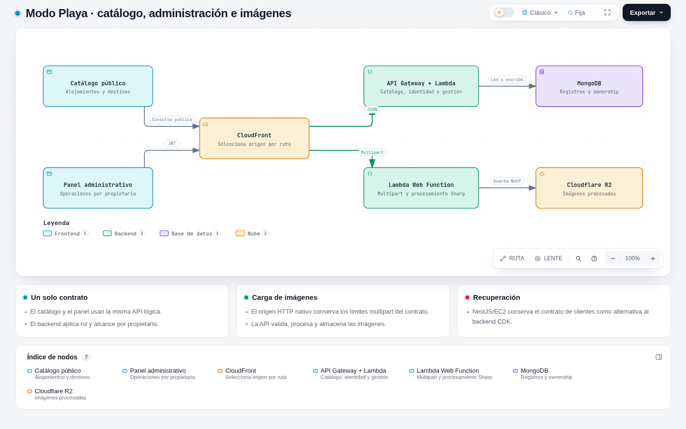

# Modo Playa Platform

[English](README.md)

Modo Playa combina un catálogo público de alojamientos, un panel administrativo autenticado y una API multi-tenant compartida. La API concentra permisos, visibilidad del catálogo y procesamiento de imágenes.

## Repositorios

- [`modo-playa-app`](https://github.com/matigaleanodev/modo-playa-app) — catálogo público en Angular e Ionic
- [`modo-playa-admin`](https://github.com/matigaleanodev/modo-playa-admin) — panel autenticado en Angular e Ionic
- [`modo-playa-api-cloud`](https://github.com/matigaleanodev/modo-playa-api-cloud) — API principal en AWS CDK y Lambda
- [`modo-playa-api`](https://github.com/matigaleanodev/modo-playa-api) — implementación NestJS conservada para recuperación

## Arquitectura

[Resumen del sistema](docs/01-overview.es.md) · [Flujos y decisiones](docs/02-architecture.es.md) · [Fuentes técnicas](docs/04-evidence.es.md)

[Fuentes del diagrama](diagrams/README.es.md)
