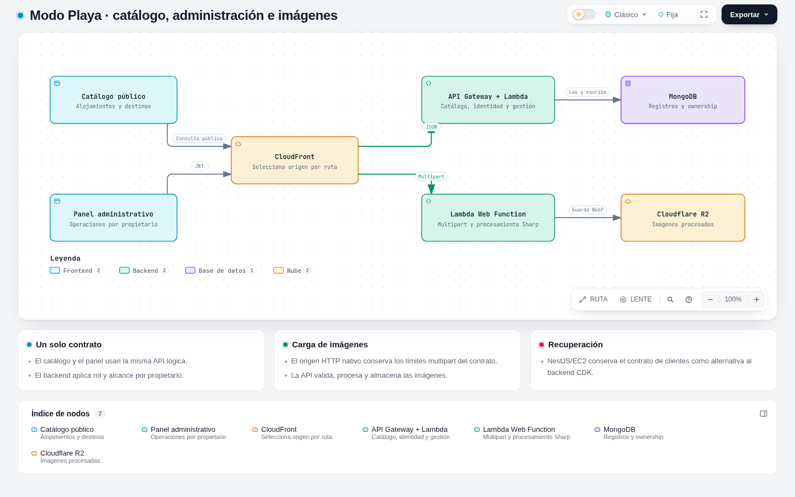

# Modo Playa Platform

[Español](README.es.md)

Modo Playa combines a public lodging catalog, an authenticated administration app, and a shared multi-tenant API. The API owns access rules, catalog visibility, and image processing.

## Repositories

- [`modo-playa-app`](https://github.com/matigaleanodev/modo-playa-app) — public Angular/Ionic catalog
- [`modo-playa-admin`](https://github.com/matigaleanodev/modo-playa-admin) — authenticated Angular/Ionic administration
- [`modo-playa-api-cloud`](https://github.com/matigaleanodev/modo-playa-api-cloud) — primary API on AWS CDK and Lambda
- [`modo-playa-api`](https://github.com/matigaleanodev/modo-playa-api) — NestJS implementation retained for recovery

## Architecture

[System overview](docs/01-overview.md) · [Flows and decisions](docs/02-architecture.md) · [Technical sources](docs/04-evidence.md)

[Diagram sources](diagrams/README.md)
